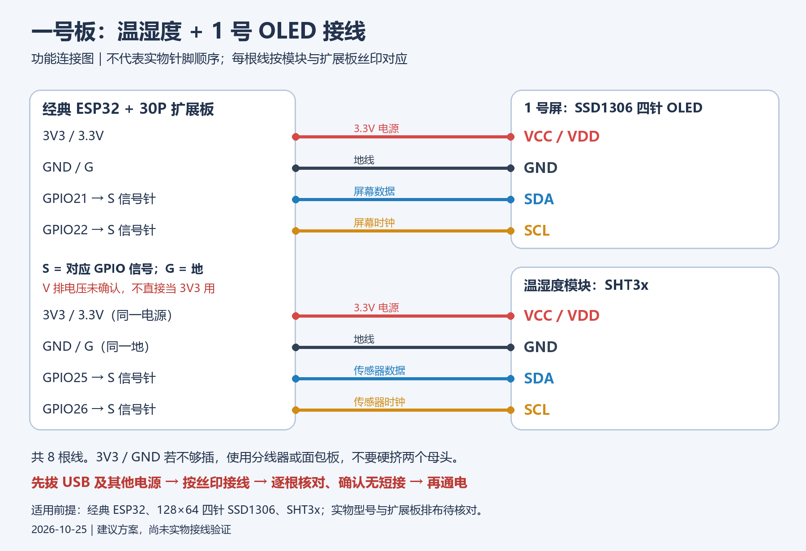

# ESP32 一号板：温湿度、热电偶与手机网页

经典 ESP32 + SSD1306 OLED + SHT3x + MAX6675 的 MicroPython 项目。板上每 2 秒读取环境温湿度与 K 型热电偶温度，OLED 轮播数值和网络地址；手机可查看实时曲线、最近 24 小时的浏览器记录，并导出 CSV 或 Excel `.xlsx`。

## 接线

断开 USB 和其他电源后接线，按模块丝印逐根核对，再通电。所有模块与 ESP32 共地；OLED、SHT3x、MAX6675 模块使用板上 **3V3** 供电。扩展板的 `D21` 等标签对应 ESP32 GPIO21 等。

| 模块 | 模块引脚 | ESP32 GPIO / 电源 |
| --- | --- | --- |
| SSD1306 128×64 OLED | SDA / SCL / VCC / GND | D21 / D22 / 3V3 / GND |
| SHT3x | SDA / SCL / VCC / GND | D25 / D26 / 3V3 / GND |
| MAX6675 | SCK / CS / SO / VCC / GND | D18 / D23 / D19 / 3V3 / GND |



图中只画了 OLED 与 SHT3x；MAX6675 以表格为准。红蓝热电偶引线应接到 MAX6675 模块的热电偶端子，不接 ESP32 的 3V3/GND；请以实际探头和模块上的极性标记核对。

## 部署

设备刷入 ESP32 版 MicroPython，电脑安装 `mpremote`。将 `main.py`、`sensor_wifi_web.py`、`sensor_dashboard.html`、`sensor_dashboard.js`、`sht_max_oled.py`、`max6675.py`、`ssd1306.py`、`oled_sht3x_monitor.py`、`dual_sensor_compare.py` 上传到设备文件系统根目录；**最后上传 `main.py` 并重启**。例如在本目录用 PowerShell：

```powershell
$port = 'COM12'  # 改成设备管理器当前显示的串口
$files = @('sensor_wifi_web.py','sensor_dashboard.html','sensor_dashboard.js','sht_max_oled.py','max6675.py','ssd1306.py','oled_sht3x_monitor.py','dual_sensor_compare.py','main.py')
foreach ($file in $files) { mpremote connect $port resume fs cp $file ":$file" }
mpremote connect $port reset
```

首次无已保存网络时，手机连接设备热点 `ESP32-Sensors-1`（默认密码 `88888888`），浏览器访问 `http://192.168.4.1`。网页可保存一个自己的 2.4 GHz Wi-Fi；连上后看 OLED 的完整 LAN IP，让其他手机加入同一网络后访问 `http://屏幕IP`。保存新网络会改变访问地址。**任何能访问网页的人都能改板子的 Wi-Fi 配置**，这是当前使用者选择的开放设置。

板上只缓存约 5 分钟；最近 24 小时记录由打开网页的手机浏览器保存。关页期间超过板上缓存的时间会留下空档。时间戳由手机接收时间和板上运行秒数估算；换了 IP 后，浏览器可能把记录保存在不同网页来源下。要长期保留数据，请及时导出 CSV 或 XLSX。DHT11 旧对比代码留作实验参考，**当前主程序不读取 DHT11**。

## 文件与验证

- `main.py`：开机入口；`sensor_wifi_web.py`：采样、OLED、热点/路由器、HTTP API。
- `sensor_dashboard.html` / `.js`：手机页面、曲线、浏览器历史与导出。
- `check_wifi_dashboard.py`：电脑端模拟 HTTP 测试；`check_wifi_browser.py`：Playwright 浏览器测试，使用模拟数据；`check_wifi_on_board.py`：板上自检脚本，会暂时占用网络服务，仅调试时运行。
- `examples/`：早期 Arduino / MicroPython 入门实验，不是当前主程序。

电脑端测试需要 Python；浏览器测试还需要 `playwright` 和浏览器运行时。先运行 `python check_wifi_dashboard.py --preview`，再在另一个终端运行 `python check_wifi_browser.py`。测试中的预览图与导出文件均为模拟数据。真实运行还要确认 OLED 翻页、手机读数持续刷新和传感器实际接线。
